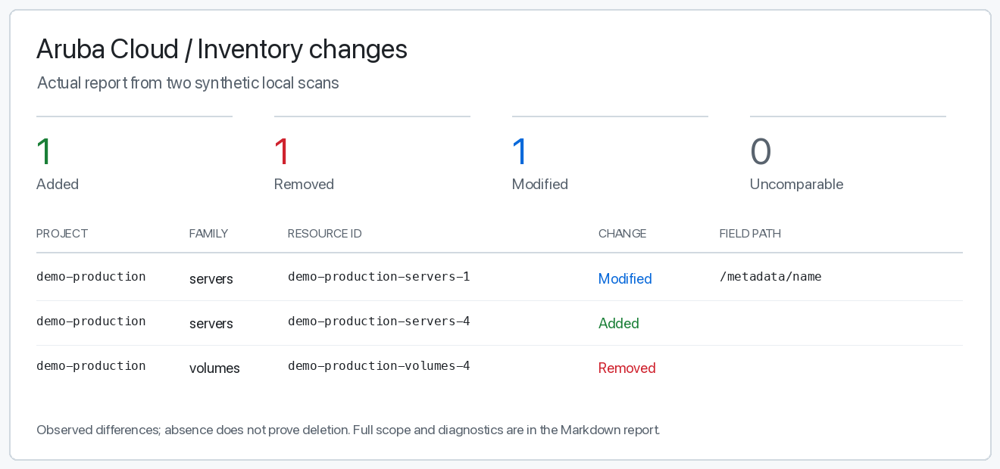

# Aruba Cloud for Codex

**Know what's in your Aruba Cloud. Ask Codex.**

Inventory your projects, turn the results into a readable report, and see what changed between scans. Use Aruba's official [`acloud` CLI](https://github.com/Arubacloud/acloud-cli) for collection and guided operations; process saved inventories entirely offline.

[](https://github.com/viames/aruba-cloud-skill/actions)
[](https://github.com/viames/aruba-cloud-skill/releases/latest)
[](LICENSE)

```text
$aruba-cloud What changed between these two inventories?
Show additions, removals, modifications, and anything you could not compare.
```

[](examples/changes.md)

**Example prompt; generated report preview.** Two real helper/CLI runs against synthetic localhost data produced this result. [Read the change report](examples/changes.md) · [Read the inventory report](examples/report.md) · [Watch the local CLI playback](assets/local-demo.gif)

[Get started](#get-started) · [Try the offline examples](#try-it-before-connecting-an-account) · [Coverage](#coverage) · [FAQ](#faq)

Independent community project, not an official Aruba product. The CLI and [Go SDK](https://github.com/Arubacloud/sdk-go) are official Aruba projects.

## Try it before connecting an account

After cloning this repository, you can generate reports from the included synthetic examples with **Python 3.10+ alone**. These commands need no CLI binary, credentials, or network access:

```sh
python3 scripts/reports.py render examples/before.json --output ./example-report.md
python3 scripts/reports.py diff examples/before.json examples/after.json --output ./example-changes.md
```

Choose new output filenames. Open the Markdown files in your editor to see per-project counts, completeness, and changes. [Report and comparison guide](references/reports.md).

## Get started

For live collection you need **Codex, Git, Python 3.10+, and macOS or Linux** on arm64/amd64. No Go installation or third-party Python packages are required. The initial CLI download needs GitHub access.

### 1. Install

```sh
git clone https://github.com/viames/aruba-cloud-skill.git "$HOME/.codex/skills/aruba-cloud"
python3 "$HOME/.codex/skills/aruba-cloud/scripts/install_cli.py"
python3 "$HOME/.codex/skills/aruba-cloud/scripts/inventory.py" doctor
```

For a custom `CODEX_HOME`, use its `skills/aruba-cloud` directory. Review local changes before replacing an existing installation. Invoke `$aruba-cloud` on your next Codex turn. `doctor` checks the local binary and configuration presence; it does not authenticate or call Aruba.

#### Install in one project with the Skills CLI

With Node.js 22.20 or later, run this from your project directory:

```sh
npx skills add viames/aruba-cloud-skill --skill aruba-cloud --agent codex
python3 .agents/skills/aruba-cloud/scripts/install_cli.py
python3 .agents/skills/aruba-cloud/scripts/inventory.py doctor
```

This installs a project-local copy under `.agents/skills/aruba-cloud`. Use that
directory in place of `$HOME/.codex/skills/aruba-cloud` in the examples below.
The first command was verified in an isolated project; it does not connect an
Aruba account. The [Skills CLI](https://github.com/vercel-labs/skills) is an
optional installer with its own requirements and telemetry controls.

### Optional: install the packaged Codex plugin

The [0.2.1 release](https://github.com/viames/aruba-cloud-skill/releases/tag/v0.2.1)
also provides a standalone plugin ZIP and a marketplace ZIP with SHA-256 checksums.
The archives package the same canonical skill, helpers and synthetic examples;
they contain no credentials or downloaded Aruba CLI binary.

Extract `aruba-cloud-0.2.1-marketplace.zip` into a permanent directory, then run:

```sh
codex plugin marketplace add /absolute/path/to/extracted/marketplace
codex plugin add aruba-cloud@viames-aruba-cloud
```

Start a new local Codex chat. The plugin's skill resolves paths from its own
directory; run its CLI installer before live collection. Existing skill-only
installation methods remain valid. Plugin packaging is separate from public
directory review and does not claim OpenAI approval.

### 2. Connect

Create a client credential in [Aruba CMP](https://my.arubacloud.com): **UTILITIES → Developer Tools → Client Credentials → Create Client Credential**. [The secret is displayed only when created](https://kb.arubacloud.com/en/utilities/api/client-credentials/creating.aspx).

In an interactive terminal, replacing `YOUR_CLIENT_ID`:

```sh
"$HOME/.codex/skills/aruba-cloud/bin/acloud" config profile set personal --client-id YOUR_CLIENT_ID
```

Enter the secret at the hidden prompt. Keep it out of chat and command-line flags. Environment credentials override saved profiles, even with `--profile`; see [credential storage and account selection](references/operations.md#credenziali).

### 3. Collect and report

Run from the installed skill directory, or ask Codex:

```sh
python3 scripts/inventory.py inventory --profile personal \
  --account-label my-account --output ./before.json
python3 scripts/reports.py render ./before.json --output ./report.md
```

Use a stable, non-secret label for the intended account. The label is supplied by you; it does not authenticate account identity. You can restrict collection with `--project-id PROJECT_ID` and `--kinds servers,volumes,vpcs`.

Later, collect a second inventory for the same account and scope:

```sh
python3 scripts/inventory.py inventory --profile personal \
  --account-label my-account --output ./after.json
python3 scripts/reports.py diff ./before.json ./after.json --output ./changes.md
```

An inaccessible family is **unknown**, never a verified zero or an automatic removal. Compatible completed scopes are compared by resource ID. Missing projects are visibility changes; absence does not prove deletion. [Comparison rules and diagnostic codes](references/reports.md).

## Ask Codex

```text
$aruba-cloud Inventory my projects and write a Markdown report.
Separate verified counts from resources you could not read.
```

```text
$aruba-cloud Compare before.json and after.json, and explain what changed.
```

```text
$aruba-cloud Inspect server SERVER_ID in project PROJECT_ID
and identify what to check before changing it.
```

Use your preferred language. Operating instructions are in Italian; CLI commands and report tools work independently of the conversation language.

## Coverage

| Capability | Available today |
| --- | --- |
| Inventory | Projects, servers, block storage, VPCs, Elastic IPs, managed databases, Kubernetes and registries |
| Markdown report | Offline per-project/family counts, completeness and diagnostics |
| Inventory comparison | Offline additions, removals, modifications and uncomparable scopes |
| Resource inspection and changes | Guided official CLI use, where supported and authorized |
| Application integration | Guidance for the official Go SDK |
| Account-free demo | Real CLI/helper against synthetic localhost data, followed by offline reporting |

Inventory `--kinds`: `servers`, `volumes`, `vpcs`, `ips`, `dbaas`, `kaas`, `registries`. Coverage is limited to **Aruba Cloud CMP** and selected families; it excludes billing, metrics, backup/snapshot inventory and some network objects. A scan is not atomic. The [operating guide](references/operations.md) covers scope and compatibility.

## FAQ

**Does this support older Aruba VPS or Cloud PRO/Smart?**

Do a separate compatibility check. An empty CMP inventory does not establish that older-platform resources do not exist. HPE Aruba Networking is outside this skill's scope.

**What does it add to the official CLI?**

Reusable Codex operating instructions, a paginated inventory helper, deterministic Markdown reports, and scope-aware inventory comparisons. The CLI remains the source of cloud operations.

**Do I need credentials to try it?**

The committed JSON examples can be rendered and compared offline with Python alone. After installing the CLI, `python3 scripts/demo.py` runs two real helper scans against a synthetic local API. Add `--output-dir NEW_DIRECTORY` to retain the demonstration JSON and Markdown files.

**Can it change my infrastructure?**

The inventory/report tools collect or process data. Guided CLI operations can change resources within the user's authorization and existing restrictions, with resulting-state checks. Installation alone grants no authorization for changes.

**What about privacy and failures?**

New report files use mode `0600` and existing files are never overwritten. Reports contain infrastructure metadata: keep them private. Incomplete reports/comparisons exit with `2`; incompatible or invalid inputs produce a diagnostic and no new Markdown file. See [exit codes](references/reports.md#exit-codes-and-output-files). Never use CLI `--debug` with real credentials in shared logs.

## Development

```sh
python3 scripts/install_cli.py
python3 scripts/test_inventory.py
python3 scripts/test_reports.py
python3 scripts/demo.py
```

Tests use the actual pinned CLI against local fixtures, plus offline report/comparison cases. CI runs on macOS and Ubuntu. Fixtures do not contact Aruba or establish live production compatibility. The installer supports macOS/Linux arm64/amd64 and verifies the official archive against [pinned SHA-256 checksums](references/provenance.json). Downloaded binaries stay in ignored `bin/`; there are no global PATH or MCP changes. A checksum is not an independent publisher signature.

See [SKILL.md](SKILL.md), [CLI operations](references/operations.md), [reports and comparisons](references/reports.md), and [SDK guidance](references/sdk.md). Review upstream compatibility and rerun tests before updating the pinned CLI; it is not silently upgraded. For an issue, include OS/architecture, CLI version and diagnostic code, with credentials and private identifiers removed.

## License

Instructions and helper code: [MIT](LICENSE), copyright 2026 Viames Marino. Downloaded CLI/SDK components retain their upstream licenses; see [third-party notices](THIRD_PARTY_NOTICES.md).
