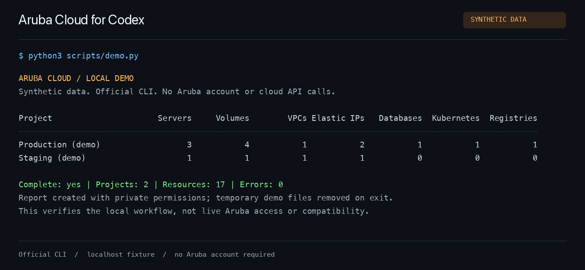

# Aruba Cloud for Codex

**Your Aruba Cloud infrastructure, one conversation away.**

Inventory your projects, inspect resources, and carry out guided operations from Codex using Aruba's official [`acloud` CLI](https://github.com/Arubacloud/acloud-cli). Start with a read-only inventory; use the official [Go SDK](https://github.com/Arubacloud/sdk-go) when you need an application integration.

[](https://github.com/viames/aruba-cloud-skill/actions)
[](LICENSE)
[](#get-started)

[Get started](#get-started) · [Try the local demo](#try-it-without-an-aruba-account) · [See coverage](#what-you-can-do) · [Read the operating guide](references/operations.md)

Community-built and independent of Aruba. This is not an official Aruba product; the CLI and SDK it uses are official Aruba projects.

## Ask Codex

After installation and account setup, try a request like:

```text
$aruba-cloud Inventory my projects and group servers, volumes, and IPs
by project. Point out any resources you could not read.
```

```text
$aruba-cloud Check my local setup and tell me what is missing
before I run my first inventory.
```

```text
$aruba-cloud Inspect server SERVER_ID in project PROJECT_ID
and identify what to check before changing it.
```

Use these prompts in your preferred language. Skill operating instructions are in Italian; CLI commands and reports are independent of the conversation language.

## See the inventory workflow

[](assets/local-demo.gif)

[Watch the 22-second walkthrough](assets/local-demo.gif) · [Read the output as text](examples/demo-output.txt)

The animation presents output from the reproducible local demo below. It uses the real inventory helper and official CLI against a localhost fixture, with synthetic credentials and resources. It does not show a live Aruba account or a Codex conversation.

## Get started

You need **Codex, Git, Python 3.10+, and macOS or Linux** on arm64 or amd64. No Go installation or third-party Python packages are required. The initial CLI download needs network access to GitHub.

### 1. Install the skill

```sh
git clone https://github.com/viames/aruba-cloud-skill.git "$HOME/.codex/skills/aruba-cloud"
python3 "$HOME/.codex/skills/aruba-cloud/scripts/install_cli.py"
python3 "$HOME/.codex/skills/aruba-cloud/scripts/inventory.py" doctor
```

For a custom `CODEX_HOME`, use its `skills/aruba-cloud` directory instead. Review local changes before replacing an existing installation. The skill will be available on your next Codex turn: invoke `$aruba-cloud` or ask to manage Aruba Cloud.

`doctor` verifies the local binary and reports configuration presence. It does **not** authenticate or call Aruba APIs.

### 2. Connect your account

Create a client credential in [Aruba CMP](https://my.arubacloud.com): **UTILITIES → Developer Tools → Client Credentials → Create Client Credential**. [The secret is displayed only when created](https://kb.arubacloud.com/en/utilities/api/client-credentials/creating.aspx).

Run this in an interactive terminal, replacing `YOUR_CLIENT_ID`:

```sh
"$HOME/.codex/skills/aruba-cloud/bin/acloud" config profile set personal --client-id YOUR_CLIENT_ID
```

Enter the secret at the hidden prompt. Keep it out of chat, command-line flags, and source control. See [credential storage and profile selection](#credentials-and-profiles) before using multiple accounts.

### 3. Run your first inventory

Ask Codex using an example above, or run the helper directly:

```sh
python3 "$HOME/.codex/skills/aruba-cloud/scripts/inventory.py" inventory \
  --profile personal \
  --output ./inventory.json
```

The helper creates a private JSON report and prints its path, completeness, project count, and error count. Choose a new output filename for each run. A complete scan exits with `0`; a partial scan exits with `2` and explains the affected scopes with diagnostic codes. A failed collection is **unknown**, not a verified zero.

## Try it without an Aruba account

Once the CLI is installed, run this from the repository or skill directory:

```sh
python3 scripts/demo.py
```

The demo runs the real inventory helper and CLI against a temporary server bound to `127.0.0.1`. It replaces inherited Aruba credentials and endpoints in the child process, uses temporary configuration, and removes its report on exit. Your saved account configuration is not changed. After the initial CLI download, the demo needs no internet connection.

Expected result: **2 demonstration projects, 17 resources, 7 resource families, and 0 errors**. This verifies the local workflow, not live Aruba access or production compatibility.

## What you can do

| Task | Available today | How it works |
| --- | --- | --- |
| Inventory projects and resources | Automated helper | Paginated collection with per-family completeness and errors |
| Inspect an individual resource | Guided CLI use | Codex checks the installed command help and selects the account, project, and resource |
| Create, change, or remove resources | Guided CLI use, where supported | Requires the user's authorization for the operation; Codex checks the resulting state |
| Build an application integration | SDK guidance | Uses APIs from the relevant official Go SDK version |
| Check local installation | Offline `doctor` command | Verifies binary integrity and configuration presence without authentication |
| Explore without an account | Local demo | Real CLI and helper, synthetic localhost API |

### Inventory coverage

| Resource | `--kinds` value |
| --- | --- |
| Cloud servers | `servers` |
| Block storage | `volumes` |
| Virtual private clouds | `vpcs` |
| Elastic IPs | `ips` |
| Managed databases | `dbaas` |
| Managed Kubernetes | `kaas` |
| Container registries | `registries` |

To restrict the project and resource families:

```sh
python3 "$HOME/.codex/skills/aruba-cloud/scripts/inventory.py" inventory \
  --profile personal --project-id PROJECT_ID \
  --kinds servers,volumes,vpcs --output ./inventory-project.json
```

Coverage applies to **Aruba Cloud CMP** and the selected families. It does not include billing, metrics, backup/snapshot inventory, all network objects, or every Aruba service. Legacy VPS and Cloud PRO/Smart products need a separate compatibility check. An empty CMP inventory does not prove that other Aruba resources do not exist. This skill does not target HPE Aruba Networking.

## Designed for careful cloud operations

- **Read-only inventory:** the helper lists resources; cloud changes use separate CLI operations within the user's authorized scope.
- **Explicit account and project:** operating instructions account for profile selection and environment overrides.
- **Honest completeness:** repeated pages, changing totals, permission errors, and incomplete collections are reported rather than silently treated as empty results. A scan is not an atomic snapshot.
- **Private reports:** new JSON files use mode `0600`; existing files are never overwritten. Reports contain infrastructure metadata and should stay private.
- **Pinned tooling:** the installer verifies the official CLI archive against a committed SHA-256 manifest and does not silently upgrade it.

### Credentials and profiles

<details>
<summary><strong>Storage, environment overrides, and authorization</strong></summary>

The CLI stores configuration in `$XDG_CONFIG_HOME/acloud/config.yaml`, defaulting to `~/.config/acloud/config.yaml`, with restricted permissions. The secret is plaintext in that file, not in a secret vault. A secret manager can instead inject `ACLOUD_CLIENT_ID` and `ACLOUD_CLIENT_SECRET` into the process environment.

Environment credentials override file profiles, **even with `--profile`**. Check for unexpected overrides when switching accounts. `doctor` reports variable names and configuration presence only; it neither reveals values nor tests authentication.

Never enable CLI `--debug` with real credentials in shared logs: it may expose authentication headers.

Installing the skill does not itself authorize resource creation, deletion, power changes, or network changes. Existing per-resource restrictions still apply, and an already authorized operation does not need repeated approval.

</details>

<details>
<summary><strong>Report semantics and CLI provenance</strong></summary>

Check both the helper's exit code and the JSON report's `complete` field. A failed family has `count: null` and `items: null`, rather than zero. Error details are reduced to local diagnostic codes to keep response bodies out of reports.

The installer downloads **acloud 1.0.0** from the official GitHub release and checks a SHA-256 pinned in [`references/provenance.json`](references/provenance.json). Downloaded binaries and installation receipts stay in ignored `bin/`. No shell profile, global executable path, or MCP configuration is changed. A checksum verifies the selected release bytes; it is not an independent publisher signature.

The installer supports macOS and Linux on arm64 and amd64. Initial integration tests were run on macOS arm64; the CI matrix runs the fixture suite on macOS and Ubuntu runners. This is not evidence of live compatibility on every platform or account.

</details>

## Development and maintenance

```sh
python3 scripts/install_cli.py
python3 scripts/test_inventory.py
python3 scripts/demo.py
```

Tests run the actual official CLI against a local HTTP/OAuth fixture with fake credentials. They cover pagination across projects, empty results across all seven families, permission failures, repeated pages, and output overwrite protection. Neither the tests nor the demo contact Aruba or create cloud resources. Passing them does not establish authenticated account access or production compatibility.

- [`SKILL.md`](SKILL.md): Codex operating instructions.
- [`agents/openai.yaml`](agents/openai.yaml): skill name, description, and starting prompt shown in Codex.
- [`references/operations.md`](references/operations.md): authentication, CLI operations, and scope.
- [`references/sdk.md`](references/sdk.md): direct Go SDK integration.
- [`references/provenance.json`](references/provenance.json): pinned release and archive checksums.
- [`scripts/demo.py`](scripts/demo.py): reproducible local demonstration.

Review upstream release notes and CLI/SDK compatibility before updating the pinned version, then re-run the fixture tests and demo. For an issue, include your OS/architecture, CLI version, exit code, and diagnostic code; remove credentials and private infrastructure identifiers.

## License

Skill instructions and helper code: [MIT](LICENSE), copyright 2026 Viames Marino. Downloaded `acloud` and its SDK dependencies retain their upstream licenses; see [third-party notices](THIRD_PARTY_NOTICES.md).
